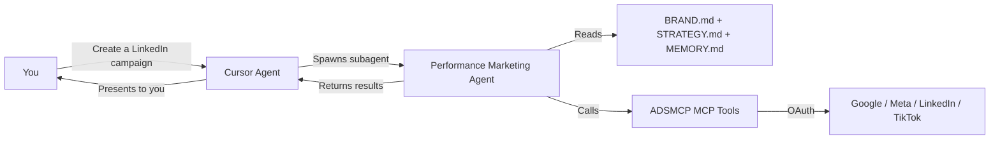

Your AI advertising manager inside Cursor. One marketplace install gives you a **Cursor subagent** with 14 skills and 2 rules that auto-trigger the right workflow for every advertising task.

## How It Works

Cursor's agent mode uses an agentic loop: you describe a task, it reasons, calls tools, reads results, and repeats. When your task involves advertising, Cursor delegates to the ADSMCP subagent — which has its own prompt, memory, skills, and MCP tools.



### What Makes Cursor Different

Two things no other client gives ADSMCP:

1. **Rules** (`.mdc` files) — they fire on context, not on a command. Mention a campaign and the brand context and safety workflow load themselves.
2. **14 separate skills** — one per platform and one per workflow, so the agent loads the TikTok pixel rules when you're on TikTok and nothing else.

***

## Install

**1. Open Customize and install ADSMCP**

In Cursor, open **Customize** in the sidebar, search **adsmcp**, select **Install**, and choose **user** scope (every project) or **project** scope (this folder only).

From chat, `/add-plugin adsmcp` does the same thing.

**2. Sign in**

The first tool call opens ADSMCP's sign-in page. Sign in, authorize, and connect your ad accounts at [adsmcp.com/connections](https://adsmcp.si/connections).

Full walkthrough with screenshots: [Cursor setup](/ai-clients/cursor). The same listing installs into [Grok Bot](/ai-clients/grok).

## What Gets Installed

| Component | Count | Where it lands | Purpose |
| - | - | - | - |
| **MCP server** | 1 | Customize → MCP | 400+ advertising tools via OAuth |
| **Subagent** | 1 | `performance-marketing-agent` | Agent prompt with brand awareness |
| **Skills** | 14 | Customize → Agent Decides | Workflow instructions per platform and task |
| **Rules** | 2 | Customize → Rules | Auto-load brand context, enforce the safety workflow |


The ADSMCP plugin on the Cursor Marketplace — 1 subagent, 14 skills, 2 rules, 1 MCP server

> [!NOTE]
>
> Nothing is copied into `~/.cursor/` by hand any more. The old `install.sh` script is retired — if you ran it, delete the `adsmcp-*` folders it left in `~/.cursor/skills/`, `~/.cursor/agents/`, and `~/.cursor/rules/` so they don't shadow the plugin.

***

## The 14 Skills

Skills appear under **Agent Decides** in Customize. Cursor matches them from what you ask; the `/` command forces one.

### Behavior and contract

| Skill | Command | What it does |
| - | - | - |
| **Agent** | `/adsmcp-agent` | Sets agent behavior and the safety rules, then routes to the right skill below |
| **MCP contract** | `/adsmcp-mcp` | How to call the ADSMCP hub — tool discovery, per-platform account IDs, quota, and the budget unit (account currency as a decimal, never cents) |

### Workflows

| Skill | Command | Steps it follows |
| - | - | - |
| **Setup** | `/adsmcp-setup` | Check connections → scan folder → pull live data → create `BRAND.md` + `STRATEGY.md` → present summary |
| **Launch** | `/adsmcp-launch` | Pick the channel for the goal → split the budget → research → build paused → confirm |
| **Optimize** | `/adsmcp-optimize` | Find waste per platform → negatives, exclusions, pacing → propose reallocation → ask before moving money |
| **Performance review** | `/adsmcp-performance-review` | Read context and strategy → pull every platform → unified scorecard → top 3 actions. Read-only |
| **Creative** | `/adsmcp-creative` | Read brand voice → pull converting search terms → write to each platform's character limits → diagnose creative fatigue |

### Platforms

| Skill | Command | What it covers |
| - | - | - |
| **Google Ads** | `/adsmcp-google-ads` | Search, PMax, Demand Gen, YouTube, Display, keywords, quality score, bid strategies, sitelinks and extensions, PMax asset groups |
| **Meta Ads** | `/adsmcp-meta-ads` | Facebook and Instagram — image, video, carousel, lead gen, ad sets, audiences, pixels, creative fatigue |
| **Amazon Ads** | `/adsmcp-amazon-ads` | Sponsored Products, Brands, Display — ASIN targeting, search-term reports, ACoS, bid optimization |
| **LinkedIn Ads** | `/adsmcp-linkedin-ads` | Sponsored content, single image, video, carousel, text ads, lead-gen forms, B2B targeting |
| **TikTok Ads** | `/adsmcp-tiktok-ads` | In-feed video, Spark Ads, carousel, app promotion, conversions |
| **ChatGPT Ads** | `/adsmcp-chatgpt-ads` | Chat-card ads inside ChatGPT responses, the one-shot launch tool, irreversible archiving |
| **Docs** | `/adsmcp-docs` | Questions about ADSMCP itself — pricing, quota, supported platforms and clients, troubleshooting |

Each platform skill carries the traps that account for most failures on that platform: TikTok's pixel-placement rule and the unsupported single-image ad, Meta's required Facebook page ID, LinkedIn's mandatory campaign group, Google's asset-bundle expiry and ad-group-ID mismatch.

### How Skills Work in Cursor

1. **Skill descriptions** are always in context — Cursor knows what's available
2. **Full skill content** loads when you invoke it or Cursor matches it automatically
3. You can invoke directly with `/adsmcp-*` or just describe what you want

Cross-platform wasted spend audit with savings estimate.

Find wasted spend across all my platforms. Show me which keywords have spend but zero conversions, which Meta ads are fatigued, and how much I could save per month.

> **[Sign up for ADSMCP — free to start](https://adsmcp.si)**
>
> 15 free tool calls/month. No credit card required. Connect your ad accounts in 2 minutes.

***

## The Two Rules

Rules are `.mdc` files that fire on context instead of on a command. You can toggle each between **Always**, **Agent Decides**, and **Manual** under **Customize → Rules**.

### brand-workspace

Auto-loads brand context on every advertising task:

* Reads `BRAND.md` before answering any advertising question
* Reads `STRATEGY.md` for active directives, and treats them as binding
* Reads past decisions from `.cursor/memory/performance-marketing-agent/MEMORY.md`
* Bootstraps a new workspace when `BRAND.md` doesn't exist
* Pulls fresh data rather than answering performance questions from memory
* Updates context files when something significant changes

### use-adsmcp

Enforces workflow safety automatically:

* Always checks connections first
* Read-before-write enforcement
* User confirmation before spend-affecting actions
* Campaign creation in PAUSED status
* Strategy directive checks before campaign creation
* Mandatory ad extensions for Google Ads campaigns
* Post-creation verification before reporting success

### Rules vs Skills

| | Rules | Skills |
| - | - | - |
| **Trigger** | Automatically based on context | Manually via `/command` or AI-matched |
| **Purpose** | Safety enforcement, context loading | Workflow instructions, tool sequences |
| **Format** | `.mdc` files | `SKILL.md` files with frontmatter |
| **What they do** | "Always check connections first" | "To create a campaign, follow these 12 steps" |

Rules and skills work together. The rule ensures safety; the skill provides the detailed workflow.

> [!NOTE]
>
> Without rules, you say "create a Google Ads campaign" and Cursor might jump straight to `create_search_campaign` — which fails because there's no keyword research, no asset validation, no strategy check.
>
> With rules, the same prompt triggers the full workflow automatically: connection check → strategy load → keyword research → asset validation → confirmation → creation → extensions → verification.

***

## Context Files

The agent uses three persistent files. Cursor's is `BRAND.md` (vs Claude Code's `CLAUDE.md`).

### BRAND.md — Brand Context

Created by `/adsmcp-setup`. Contains brand overview, voice, audiences, connected platforms, budgets, KPI targets, and performance snapshot.

| Section | Source |
| - | - |
| Brand Overview | Your docs + ADSMCP data |
| Brand Voice | Your docs (tone, style, prohibited words) |
| Active Platforms | `get_connections_status` |
| Budget & Guardrails | Your docs + campaign data |
| Performance Snapshot | Last 30 days from ADSMCP |

If you already have a `BRAND.md` that isn't an ADSMCP workspace — a software project's instructions, say — the agent leaves it untouched and tells you so, rather than writing over it.

### STRATEGY.md — Strategic Decisions

Persists directives across sessions:

```markdown theme={"theme":{"light":"github-light","dark":"github-dark"}}
### Google Ads
AVOID: broad match "plumbing services" — competitor-dominated, $12+ CPC
PREFER: exact match "emergency plumber [city]" — high intent, $4-6 CPC
```

### MEMORY.md — Past Decisions

Located at `.cursor/memory/performance-marketing-agent/MEMORY.md`. Tracks campaign actions, optimization results, and learnings.

***

## The Agent Loop

When you invoke `/adsmcp-performance-review` in Cursor:

**1. Rule activates**

`brand-workspace` fires, loading `BRAND.md` and `STRATEGY.md` into context.

**2. Skill loads**

Cursor matches the performance review skill and loads its full workflow instructions.

**3. Agent spawns**

The performance marketing subagent starts with brand context, strategy, and memory.

**4. Data pull**

For each connected platform, calls performance and wasted spend tools via ADSMCP MCP.

**5. Strategy check**

Compares campaign data against `STRATEGY.md`. Flags "Strategy Drift" items.

**6. Results**

Presents a unified scorecard with recommendations and top 3 actions.

***

## Web Research

Cursor's agent has access to `WebSearch` and `WebFetch` for competitive research. Before creating any campaign, the agent:

1. Crawls your website for positioning, pricing, and value propositions
2. Searches for and crawls competitor websites
3. Combines web data with ADSMCP data (search terms, keyword volumes)
4. Presents a research brief before building your campaign

***

## Safety Rules

| Rule | How It Works |
| - | - |
| User confirmation for spend | Agent always asks before creating campaigns or changing budgets |
| Campaigns created PAUSED | All `create_*` tools default to PAUSED status |
| Read-before-write | Connection check → research → validate → create |
| Never retry on error | Reports the error instead of retrying |
| Budget guardrails | Checks `BRAND.md` budget limits before spend-affecting actions |
| Strategy compliance | Reads `STRATEGY.md` and flags conflicts |
| Post-creation verification | Verifies ad groups, keywords, ads, and extensions |
| Rules enforcement | `use-adsmcp` auto-triggers safety checks |
| No credentials in the plugin | OAuth 2.1 with PKCE; the marketplace build ships no hooks or executables and talks only to `https://mcp.adsmcp.si/mcp` |

***

## Comparison with Other Clients

| Feature | Cursor | Grok Bot | Claude Code | Codex |
| - | :-: | :-: | :-: | :-: |
| Install from | Customize | Plugins | `/plugin install` | `codex plugin` |
| Agent type | Subagent | Bot description | Subagent | Agent config |
| Brand context | `BRAND.md` | Bot description | `CLAUDE.md` | `AGENTS.md` |
| Skills | 14 | 14 | 1 comprehensive | 5 separate |
| Commands | `/adsmcp-*` | -- | `/adsmcp:*` | `$adsmcp-*` |
| Memory | `MEMORY.md` | -- | `MEMORY.md` | Not available |
| Rules (auto-trigger) | 2 rule files | -- | -- | Safety rules |
| Scheduling | ADSMCP tools | Routines | ADSMCP tools | ADSMCP tools |
| Web research | `WebSearch` + `WebFetch` | Built in | `WebSearch` + `WebFetch` | Not available |

***

## FAQ

> **Do I need the rules to use ADSMCP?**
>
> No, but they make everything smoother. Without rules, you need to be more explicit ("first check my connections, then research keywords"). With rules, safety checks and context loading happen automatically.

> **Can I edit the rules and skills?**
>
> The plugin's copies update with the plugin, so edit them by adding your own alongside. Put project rules in `.cursor/rules/` and personal skills in `~/.cursor/skills/` — yours load next to ADSMCP's. To change a default outright, fork [the plugin repo](https://github.com/ADSMCP/adsmcp-cursor-plugin) and load it from `~/.cursor/plugins/local`.

> **What's the difference between the subagent and Composer?**
>
> Cursor's Composer is the main agent mode for coding tasks. The ADSMCP subagent is a specialized agent that Composer delegates to when advertising tasks come up. The subagent has its own context, so ad workflows don't bloat your coding session.

> **Can I use ADSMCP in Cursor without the agent?**
>
> Yes. The agent is one part of the plugin, and the 400+ tools work from any Cursor chat whether or not the subagent is invoked. Install the plugin from the Cursor Marketplace either way. It's **Verified by Cursor**, and it's the supported way to connect. Don't add the MCP server by hand. You'd lose brand awareness, workflow enforcement, strategy persistence, and memory, and a second copy of the server duplicates every tool.

> **Is the plugin open source?**
>
> Yes — [ADSMCP/adsmcp-cursor-plugin](https://github.com/ADSMCP/adsmcp-cursor-plugin), MIT licensed. Cursor requires marketplace plugins to be open source and reviews every update before it ships.

## Related Documentation

* [Cursor Setup](/ai-clients/cursor) — installation guide with screenshots
* [Grok Bot Setup](/ai-clients/grok) — the same plugin, running in the cloud
* [Claude Code Agent](/agent-skills/claude-code-agent) — How ADSMCP works in Claude Code
* [Codex Agent](/agent-skills/codex-agent) — How ADSMCP works in Codex
* [Performance Marketing Agent](/agent-skills/agent) — Architecture overview
* [Skill Reference](/agent-skills/skills) — All skills with invocation details
* [Prompt Engineering Playbook](/agent-skills/prompt-engineering-playbook) — A custom skill, account dossier, and prompt book generated from your own ad account (\$39 one-time, one free on annual)

{/* domain: adsmcp.si */}
