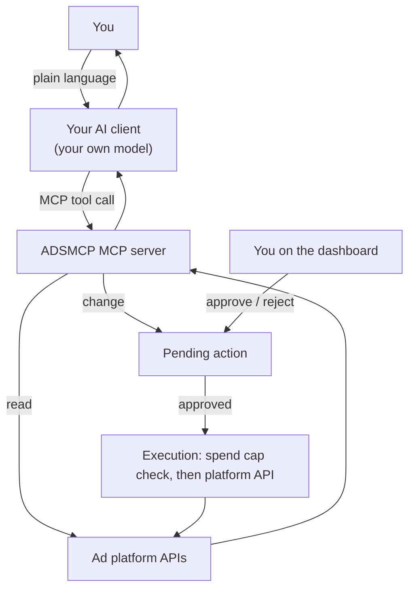

## 1. Your AI client

Claude, ChatGPT, Codex, Cursor, Gemini CLI or any MCP client. It runs your own model: it understands the request, chooses ADSMCP tools, and writes the answer. With the [Agent Pack](/mcp-setup#agent-pack-skills-and-slash-commands) it follows the five ADSMCP [workflows](/workflows).

## 2. The ADSMCP MCP server

`https://mcp.adsmcp.si/mcp`. It checks who is calling (OAuth or API key; see [Authentication](/authentication)), counts the call against your plan, and runs the tool for your connected accounts. Your AI client never talks to the ad platforms directly.

## 3. Reads

A read calls the platform API (or computes over data you pass in) and returns JSON. Nothing changes.

## 4. Changes and approval

A change is never applied on the call. ADSMCP validates it and stores it as a pending action:

- Only a person approves it, on the dashboard [Approvals](https://adsmcp.si/dashboard/approvals) page. MCP and REST can list and reject pending actions, not approve them.
- Deletes need `confirm_delete: true` before they are staged.
- After approval the change runs from the execution queue. Creates are made paused or as drafts. Budget changes and enables are checked against your [spend cap](/safety#spend-cap). A failed run is not retried automatically.

## 5. Results

The JSON result goes back to your client, which presents it. Approved changes, failures and audit history are on the dashboard (Approvals, Execution Queue).

## Where data lives

Your connections, settings and audit history are stored in ADSMCP's database; platform tokens are kept in Supabase Vault. See [Security](/security).

{/* domain: adsmcp.si */}
