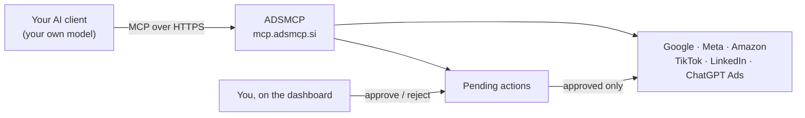

ADSMCP is a remote MCP (Model Context Protocol) server. Your AI client connects to it and calls ADSMCP tools; ADSMCP calls the ad platforms on your behalf with the accounts you connected on the dashboard.



## Server URL

```text
https://mcp.adsmcp.si/mcp
```

The same URL works for every client. ADSMCP is not listed in any AI app's directory; add the URL yourself (see [Add to your agent](/add-to-your-agent)).

## Transport and sign-in

- **Streamable HTTP** at the URL above. Clients that only run local servers can use the [STDIO proxy](/mcp-setup#stdio-proxy).
- **OAuth** (PKCE S256, dynamic client registration) for Claude, ChatGPT and clients with a `localhost` callback. Access tokens last 1 hour; refresh tokens 30 days.
- **API keys** (`Authorization: Bearer sk_live_...`) for every other client.

Details: [Authentication](/authentication), [MCP protocol](/mcp-protocol).

## Tool discovery

`/mcp` lists a compact surface: a read and a write router per platform (`google_ads_read`, `meta_ads_write`, …) plus `search_tools` and `get_tool_schema`, so a client does not load every tool definition up front. `/mcp/flat` lists every tool by name. The [API reference](/api-reference/introduction) documents each tool.

## What happens on a call

- **Reads** go to the platform (or ADSMCP's own analysis) and return JSON right away.
- **Changes** are checked and stored as a pending action. The response tells your client the change is waiting. A person approves or rejects it on the dashboard [Approvals](https://adsmcp.si/dashboard/approvals) page; MCP can view or reject, never approve.
- When an approved change runs: creates are made paused or as drafts, budget changes and enables are checked against your [spend cap](/safety#spend-cap), and a failure is not retried automatically.
- `remove_*` / `delete_*` tools need `confirm_delete: true` before anything is staged.

## Your model, not ours

ADSMCP does not run an AI model for your requests. Your client's model decides which tools to call and writes the answer. ADSMCP returns data and computed findings (rankings, scores, validation results).

## Plans and limits

Each tool call counts against your plan; see [Pricing](/pricing). `get_usage_status` returns your usage.

{/* domain: adsmcp.si */}
