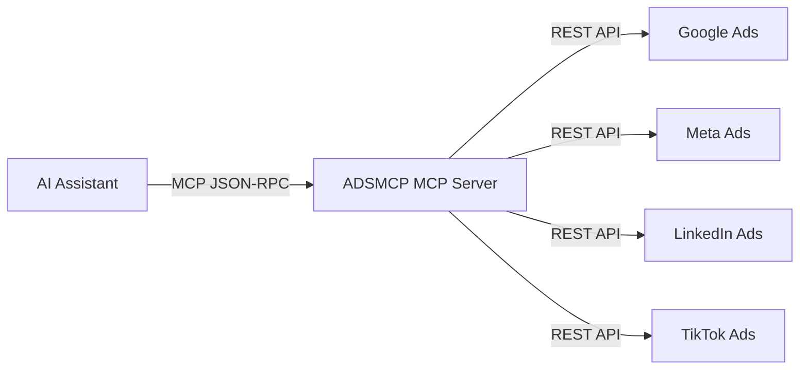
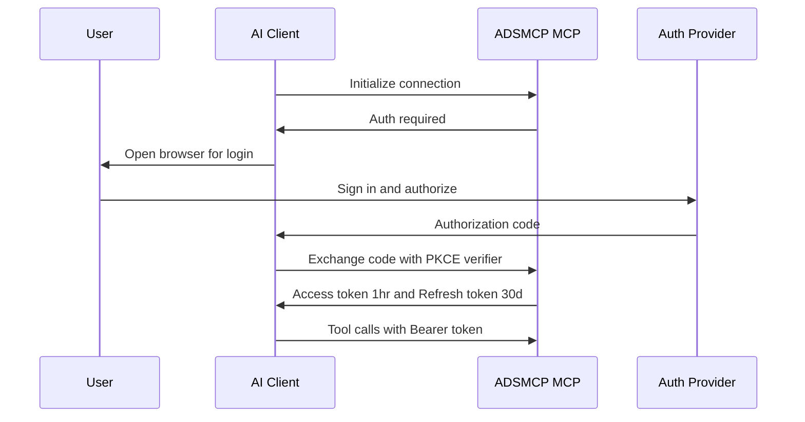

ADSMCP connects AI assistants to ad platforms using MCP — the open protocol created by Anthropic for AI tool integration.

## What is MCP?

Model Context Protocol (MCP) is an open standard that lets AI assistants call external tools. Instead of each AI client building custom integrations, MCP provides a universal interface:



One server, any AI client. Your ADSMCP account works with ChatGPT, Claude, Claude Code, Gemini CLI, Cursor, Grok Bot, Codex, OpenClaw, Windsurf, Perplexity, and Manus — all connecting to the same endpoint.

## MCP Server URL

> [!NOTE]
>
> **MCP Server URL:** `https://mcp.adsmcp.si/mcp`
>
> This single URL is used across all AI clients. The server auto-detects the transport type based on the client's request.

> [!NOTE]
>
> **In Claude, Cursor, and Grok Bot you don't paste this URL.** Install ADSMCP from each app's official listing: the Anthropic-verified Claude connector, or the Verified by Cursor plugin, which Grok Bot also uses. Those listings point at this server for you. Paste the URL in ChatGPT, as a custom MCP server ([steps](/ai-clients/chatgpt)), since the ChatGPT plugin is having issues right now, and in clients without a listing (Windsurf, Gemini CLI, Perplexity, Manus, custom clients). See [Add to Your Agent](/add-to-your-agent) for every client.

## Transport

ADSMCP supports two MCP transport mechanisms:

| Transport | Used By | How It Works |
| - | - | - |
| **Streamable HTTP** | ChatGPT, Claude, Cursor, Grok Bot, Windsurf, Perplexity, Manus | HTTP POST for requests, SSE (Server-Sent Events — one-way streaming from server to client over HTTP) for streaming responses. Supports progress updates during long operations. |
| **STDIO** | Claude Code (local) | JSON-RPC over stdin/stdout. Used for local terminal-based tools. |

### Streamable HTTP

The primary transport for web and IDE clients. Requests are JSON-RPC 2.0 over HTTP:

```json Example MCP Request theme={"theme":{"light":"github-light","dark":"github-dark"}}
{
  "jsonrpc": "2.0",
  "id": "req-1",
  "method": "tools/call",
  "params": {
    "name": "get_campaign_performance",
    "arguments": { "lookback_days": 30 }
  }
}
```

Responses stream back via SSE with heartbeats every 30 seconds, allowing real-time progress updates during campaign creation (which can take 5-30 seconds).

### Why Not WebSockets?

SSE is HTTP-native — works through firewalls, proxies, and CDNs without special configuration. WebSockets require persistent connections that many enterprise networks block.

## Authentication

ADSMCP uses **OAuth 2.1 with PKCE (Proof Key for Code Exchange — prevents authorization code interception attacks)** — the most secure standard for AI tool authentication.

### How It Works



### Key Security Properties

* **PKCE (Proof Key for Code Exchange):** Prevents authorization code interception. Every auth flow generates a unique code verifier — even if someone intercepts the code, they can't use it without the verifier.
* **Short-lived tokens:** Access tokens expire in 1 hour. Refresh tokens last 30 days.
* **No passwords stored:** ADSMCP never sees your Google, Meta, Amazon, LinkedIn, or TikTok passwords. OAuth tokens are scoped to only the permissions you authorize. (ChatGPT Ads connects with a pasted API key, stored encrypted — never a password.)
* **Revocable:** Disconnect anytime from your ad platform's security settings or from [adsmcp.ai](https://adsmcp.si?utm_source=docs\&utm_medium=page\&utm_content=account).

### API Key Authentication

For headless environments (remote servers, Docker, CI/CD) where a browser isn't available, ADSMCP also supports **Personal Access Tokens** (API keys):

* Generate a key at [adsmcp.ai/keys](https://adsmcp.si/dashboard/api-tokens) — starts with `sk_live_`
* Pass it via `--token` flag or `ADSMCP_API_KEY` environment variable
* The server validates API keys using SHA-256 hash lookup (no browser redirect needed)
* API keys provide the same access as OAuth tokens — same tools, same quotas

See [Security & Data Privacy](/knowledge-base/security#api-key-authentication) for full details.

## Tool Discovery

When an AI client connects, it discovers available tools via `tools/list`:

```json Tool Discovery Request theme={"theme":{"light":"github-light","dark":"github-dark"}}
{
  "jsonrpc": "2.0",
  "id": "req-0",
  "method": "tools/list"
}
```

The server returns the tool surface with names, descriptions, and input schemas. The AI client uses these schemas to understand what parameters each tool accepts and to validate inputs before calling.

> [!NOTE]
>
> **Scalable discovery for a 400+ tool surface.** Rather than flooding the client with every tool at once, ADSMCP fronts each platform with a compact **router tool** (`google_ads`, `meta_ads`, `amazon_ads`, …). The AI calls the router with `action: "list_tools"` to discover what's available, then `action: "execute"` to run a specific tool. Two helper tools make this reliable as the surface grows: **`search_tools`** finds the right tool from a natural-language description of the task, and **`get_tool_schema`** returns a tool's exact parameters before it's called. This keeps the AI accurate even across hundreds of tools.

### Tool Categories

| Category | Tools | Examples |
| - | - | - |
| **Read** (`get_*`, `list_*`, `analyze_*`) | \~60 | Pull performance data, list campaigns, analyze trends |
| **Write** (`create_*`, `update_*`) | \~25 | Create campaigns, update budgets |
| **System** (`get_connections_status`, `switch_primary_account`) | \~8 | Account management, connection checks |
| **Automation** (`schedule_*`, `create_monitor`) | \~8 | Recurring tasks, alerts |

### Tool Safety Model

* **Read tools** auto-execute — no confirmation needed
* **Write tools** require user confirmation before execution
* **Destructive tools** (`remove_*`, `delete_*`) carry a `destructiveHint` and are hard-gated: they won't run unless the call explicitly passes `confirm_delete: true`, and a "pause" request will never be routed to a delete tool. This prevents an ambiguous instruction (e.g. "pause these keywords") from permanently deleting anything.
* All campaigns are created **PAUSED** — you review before spending

## Tool Execution

When the AI calls a tool, the server:

1. **Validates input** — Checks types, ranges, and required fields against the tool's JSON Schema
2. **Authenticates** — Verifies the OAuth token or API key and resolves the user's ad accounts
3. **Checks quota** — Confirms the user has tool calls remaining on their plan
4. **Executes** — Calls the relevant ad platform API (Google, Meta, Amazon, ChatGPT Ads, LinkedIn, or TikTok)
5. **Returns results** — Formatted text response with tables, recommendations, or confirmation

### Error Handling

If something goes wrong, the server returns structured errors with recovery steps:

```json Error Response Example theme={"theme":{"light":"github-light","dark":"github-dark"}}
{
  "error": {
    "code": -32002,
    "message": "No Google Ads account connected",
    "data": {
      "recovery_steps": [
        "Visit adsmcp.ai/connections",
        "Click 'Connect Google Ads'"
      ]
    }
  }
}
```

## Quota System

ADSMCP uses a tool-call-based pricing model:

| Plan | Tool Calls/Month | Monthly | Annual |
| - | - | - | - |
| Free Forever | 15 | \$0 | — |
| Plus | 150 | \$49/mo | \$485/yr |
| Pro | 600 | \$99/mo | \$999/yr |
| Max | 3,000 | \$199/mo | \$2,000/yr |

Each tool invocation counts as 1 call regardless of platform. A typical campaign creation uses 4-6 calls (research + validate + create). Performance queries use 1 call each.

See [full pricing](https://adsmcp.si/pricing).

## Infrastructure

| Component | Technology |
| - | - |
| **Runtime** | Python 3.11 + FastAPI (async) |
| **MCP SDK** | Official MCP Python SDK |
| **Hosting** | Google Cloud Run (auto-scaling) |
| **Sessions** | Redis (auto-expiring, 1hr TTL) |
| **Auth** | OAuth 2.1 with PKCE |
| **Logging** | Structured JSON logs |

### Server Architecture

**mcp.adsmcp.si**

**OAuth 2.1 + PKCE**

**JSON-RPC 2.0 Router**

**tools/list — Discover 400+ tools**

**tools/call — Execute tool with auth**

**Platform Adapters**

**Google Ads API (156 tools)**

**Meta Marketing API (60 tools)**

**Amazon Ads API (61 tools)**

**ChatGPT Ads / OpenAI Ads API (36 tools)**

**LinkedIn Marketing API (55 tools)**

**TikTok Marketing API (37 tools)**

**Redis Sessions (1hr TTL)**

### Uptime

The MCP server runs on Cloud Run with minimum 1 instance always warm — no cold starts for the first request. Auto-scales based on concurrent connections.

## Supported Clients

Any MCP-compatible client can connect. Currently tested and documented:

| Client | Transport | Setup Guide |
| - | - | - |
| ChatGPT (Plus/Pro) | Streamable HTTP | [ChatGPT Setup](/ai-clients/chatgpt) |
| Claude (Pro/Max/Team/Enterprise) | Streamable HTTP | [Claude Setup](/ai-clients/claude) |
| Claude Code | STDIO | [Claude Code Setup](/ai-clients/claude-code) |
| Gemini CLI | Streamable HTTP | [Gemini CLI Setup](/ai-clients/gemini-cli) |
| Cursor | Streamable HTTP | [Cursor Setup](/ai-clients/cursor) |
| Grok Bot | Streamable HTTP | [Grok Bot Setup](/ai-clients/grok) |
| Codex | Streamable HTTP | [Codex Setup](/ai-clients/codex) |
| OpenClaw | Streamable HTTP | [OpenClaw Setup](/ai-clients/openclaw) |
| Windsurf | Streamable HTTP | [Windsurf Setup](/ai-clients/windsurf) |
| Perplexity (Pro/Max/Enterprise) | Streamable HTTP | [Perplexity Setup](/ai-clients/perplexity) |
| Manus | Streamable HTTP | [Manus Setup](/ai-clients/manus) |

## FAQ

> **What's the difference between the MCP server and the docs MCP?**
>
> Two separate things. The **product MCP server** at `mcp.adsmcp.si/mcp` connects AI assistants to ad platforms (400+ tools). The **docs MCP** at `www.adsmcp.com/docs/mcp` is auto-generated by Mintlify and lets AI assistants search ADSMCP's documentation. They serve different purposes.

> **Can I build my own MCP client that connects to ADSMCP?**
>
> Yes. Any client implementing the MCP specification can connect. Use the MCP SDK for your language (Python, TypeScript, etc.), point it at `https://mcp.adsmcp.si/mcp`, and implement OAuth 2.1 for authentication.

> **Is MCP the same as an API?**
>
> MCP is a protocol layer on top of HTTP. Think of it as a standardized way for AI assistants to discover and call APIs. Instead of writing custom API integration code, the AI client speaks MCP and automatically understands what tools are available and how to call them.

> **Why not just use a REST API?**
>
> MCP adds tool discovery, streaming, and a standard authentication flow that AI clients already understand. With a REST API, each AI client would need custom integration code. With MCP, any compliant client connects immediately — no custom code needed.

## Related Documentation

* [Quickstart](/quickstart) — Get connected in 5 minutes
* [Agent Skills](/agent-skills/overview) — Teach your AI the right workflows
* [Core Workflows](/agent-skills/workflows) — Tool sequences for every platform
* [Pricing & Plans](https://adsmcp.si/pricing)
* [Prompt Engineering Playbook](/agent-skills/prompt-engineering-playbook) — A custom skill, account dossier, and prompt book generated from your own ad account (\$39 one-time, one free on annual)

{/* domain: adsmcp.si */}
